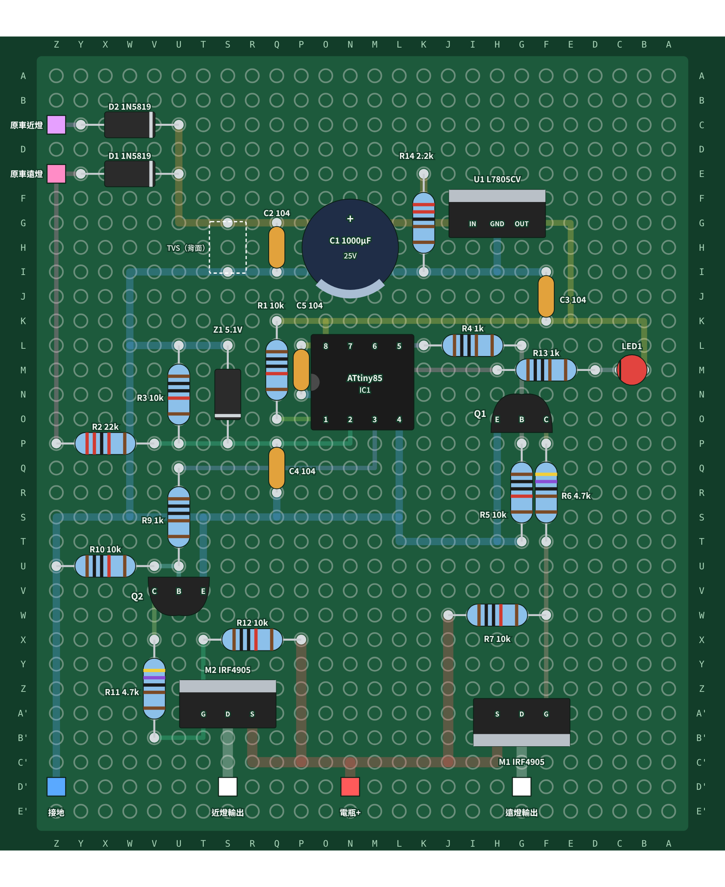
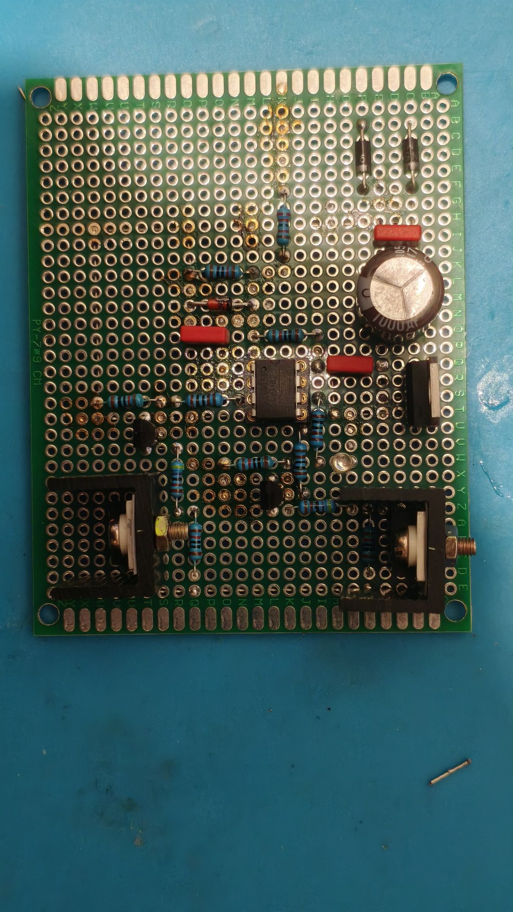

# ATtiny85 機車大燈控制器（強光線組版）

用一顆 ATtiny85 自製的機車大燈控制器，功能仿照市售的「DSP 智能大燈模組」：平常近燈可以關掉，想開時把遠燈開關撥一下就能切換。燈的電流直接從電瓶供應（強光線組），原車開關只當訊號用。

已經做成洞洞板、實際裝在 LED 大燈的機車上使用。



**[互動佈線圖](https://allentsou.github.io/attiny85-headlight-toggle/hardware/perfboard.html)**：點線路可單獨標亮，附每個零件的孔位表。

作者的原型板（手工佈線，零件位置和上圖不同，電路相同）：



## 功能

- 發動後**近燈預設關**。
- 把把手撥到遠燈約 **2 秒**，遠燈會**熄一下**當提示；這時**馬上撥回近燈**，近燈就會「開／關」切換。
- 提示後超過 0.8 秒才撥回，視為正常使用遠燈，不切換。超車閃燈（按不到 2 秒）完全不受影響。
- 遠燈直接跟著開關走，沒有延遲。
- 開遠燈時會關掉近燈（程式裡 `LOW_WITH_HIGH` 可改成遠近同亮）。
- 熄火後控制器完全斷電，不吃電瓶。
- 看門狗：被雜訊干擾當機時 0.5 秒內自動重開，騎車中重開會保留近燈狀態。

### 狀態燈

| 狀態燈 | 意思 |
|---|---|
| 通電時閃 1 下 | 正常開機 |
| 通電時閃 3 下 | 上次被看門狗重啟過（曾受雜訊干擾） |
| 恆亮 / 不亮 | 近燈開 / 近燈關 |
| 快閃 | 遠燈提示後的確認時間，這時撥回近燈就會切換 |

## 運作原理

```
原車近燈線 ──1N5819──┐
原車遠燈線 ──1N5819──┴─ VIN ── TVS / 1000µF / 放電電阻 ── L7805 ── 5V ── ATtiny85
     │
     └─ 22k / 10k 分壓 + 5.1V 稽納 ── PB3（偵測遠燈開關）

ATtiny85 PB0 ── 1k ── SS8050 ── 4.7k ── IRF4905（P-MOS）── 遠燈
ATtiny85 PB4 ── 1k ── SS8050 ── 4.7k ── IRF4905（P-MOS）── 近燈
                                          ↑
                         電瓶+（經保險絲）接兩顆 MOS 的 S 腳
```

- **MCU 供電**：從原車近燈、遠燈線經二極體取電，所以熄火就斷電。
- **遠燈偵測**：用 ADC 讀電壓並加遲滯，9V 以上算開、6V 以下算關，中間維持原狀，避免下雨天開關漏電誤判。
- **驅動**：MCU 的 5V 不能直接控制接在 12V 的 P-MOS，所以用 SS8050 做轉換。MOS 是高側開關，燈的地線直接回車架。

## 檔案

| 路徑 | 內容 |
|---|---|
| [`firmware/headlight_toggle/`](firmware/headlight_toggle/headlight_toggle.ino) | Arduino 程式（ATTinyCore） |
| [`hardware/BOM.md`](hardware/BOM.md) | 零件清單 |
| [`hardware/perfboard.md`](hardware/perfboard.md) | 洞洞板佈線圖與每個零件的孔位 |
| [`hardware/perfboard.html`](https://allentsou.github.io/attiny85-headlight-toggle/hardware/perfboard.html) | 互動佈線圖（線上開啟，或下載後用瀏覽器開） |
| [`hardware/kicad/`](hardware/kicad/) | KiCad 10 原理圖、PCB（已送 JLCPCB 製作，尚未驗證）與 Gerber |
| [`docs/programming.md`](docs/programming.md) | 用 USBasp 燒錄的完整步驟 |
| [`docs/troubleshooting.md`](docs/troubleshooting.md) | 實際遇過的問題和解法 |

## 製作步驟

1. 照 [零件清單](hardware/BOM.md) 備料。
2. 照 [洞洞板佈線](hardware/perfboard.md) 焊接。**C5（IC 旁的 104）和 R14（C1 旁的 2.2k 放電電阻）不能省**，少了這兩顆通電時偶爾會開機失敗。
3. 先不插晶片，接 12V 量 IC 座第 8 腳對第 4 腳要約 5V。
4. 照 [燒錄說明](docs/programming.md) 燒好 ATtiny85，插上 IC 座。
5. 在桌上接 12V 和負載測試：電瓶+ 和地線先接好不動，原車近燈線串一個撥動開關模擬鑰匙，原車遠燈線也接一個開關，反覆開關幾十次確認每次都正常開機、切換。
6. 裝上車。

## 裝車注意事項

- **保險絲**靠近電瓶正極裝。LED 大燈遠近燈全開約 2.5A，用 5A 保險絲即可。
- **原車大燈插頭不要剪**，用公母對插頭轉接。控制器故障時可以直接插回原廠線路。
- IRF4905 的金屬背板就是汲極（燈的輸出）。有裝散熱片且沒墊絕緣片的話，**散熱片帶電，不能碰到車架**或彼此碰到。
- 板子塗三防漆或裝盒防水，用束帶固定防震；晶片可以點一點熱熔膠固定在 IC 座上。
- 只適用**直流大燈**。老式交流大燈（發電線圈直供）要另外設計。
- 本作者的車是**內建驅動器的 LED 大燈**，遠燈模式時燈本身會連近燈一起點亮，這是燈的行為，不是控制器的問題。

## 免責聲明

- 台灣新車多為大燈常亮（AHO）設計，**夜間或隧道不開大燈會被取締**，也有安全疑慮。這個控制器建議只在白天或停車時關近燈。
- 改裝車輛電系有風險，請自行評估，作者不對任何損壞或事故負責。

## 授權

[MIT License](LICENSE)：程式、電路、PCB 和文件都可以自由使用、修改、商用，保留版權聲明即可。
