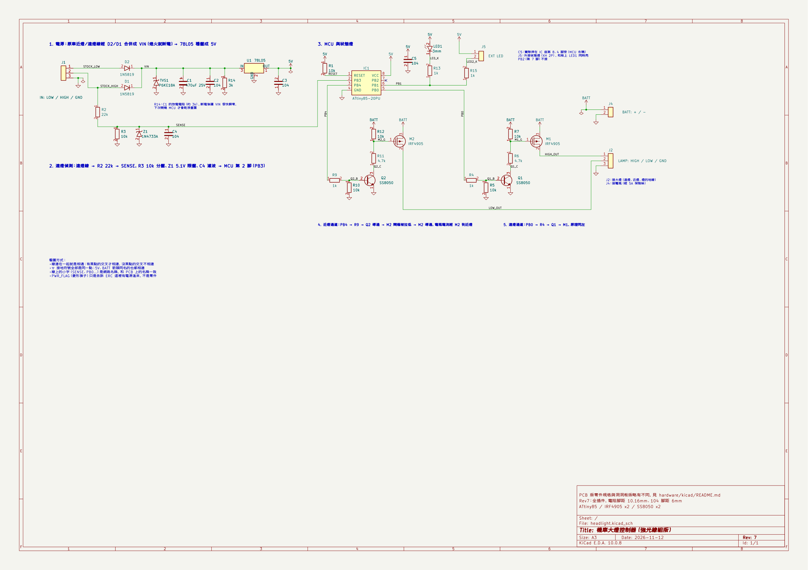
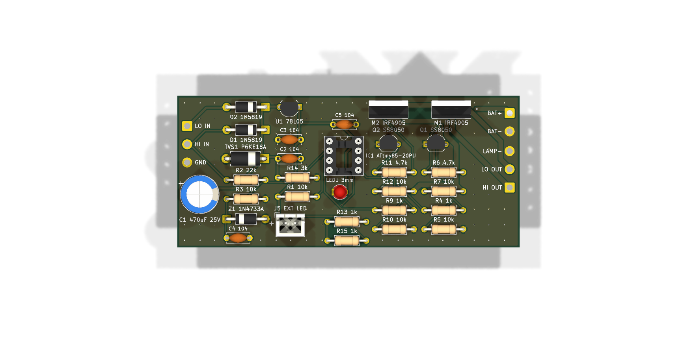

# KiCad 原理圖與 PCB（KiCad 10）

用 KiCad 10 開 `headlight.kicad_pro`。原理圖、PCB 都在這個資料夾，零件符號與封裝隨專案附上（`headlight.kicad_sym`、`headlight.pretty/`），不用另外裝庫。

| 檔案 | 內容 |
|---|---|
| `headlight.kicad_sch` | 原理圖 |
| `headlight.kicad_pcb` | PCB（90 × 40 mm，雙層板，全插件） |
| `headlight.pdf` | 原理圖 PDF，沒裝 KiCad 也能看 |
| `gerber/headlight_rev7_jlcpcb.zip` | Gerber＋鑽孔檔，可直接上傳嘉立創（JLCPCB）等板廠 |

ERC、DRC（含原理圖與 PCB 一致性檢查）都是 0 錯誤。

> [!WARNING]
> **這片 PCB 已送嘉立創（JLCPCB）製作，還沒組裝驗證。** 作者目前裝在車上的是洞洞板版本（見 [perfboard.md](../perfboard.md)），電路相同，但 PCB 的佈線是另外畫的。板子到貨、實測後會更新這裡；在那之前想打板的話請自行承擔風險。

## PCB 版和洞洞板版的差異

電路相同，只有幾顆零件規格不同（[零件清單](../BOM.md) 是照洞洞板寫的）：

| 編號 | PCB 版（本資料夾） | 洞洞板版（BOM） | 說明 |
|---|---|---|---|
| U1 | 78L05（TO-92） | L7805CV（TO-220） | 控制器只吃幾 mA，兩種都可以 |
| C1 | 470µF 25V | 1000µF 25V | 兩種都夠 |
| TVS1 | P6KE18A（插件） | SMBJ18A（貼片） | 都是單向 18V，不要用 CA 雙向 |
| R14 | 3k | 2.2k | C1 放電電阻，2.2k～4.7k 都可以 |
| R15、J5 | 有 | 無 | 外接第二顆狀態燈（JST XH 2P），和板上 LED1 同時亮；不用可不焊 |
| J1、J2、J4 | 焊線孔 | 直接焊線 | J1 原車訊號輸入、J2 燈輸出、J4 電瓶 |

其他零件編號和 [零件清單](../BOM.md)、[洞洞板佈線](../perfboard.md) 一致。

## 看原理圖

- 有黑點的交叉才相連，沒黑點的交叉不相連。
- 接地符號全部相連；5V、BATT 箭頭同名的也相連。
- 線上的小字（SENSE、PB0…）是網路名稱，和 PCB 上的名稱一致。
- PWR_FLAG（菱形旗子）只是告訴 ERC 這裡有電源進來，不是零件。
