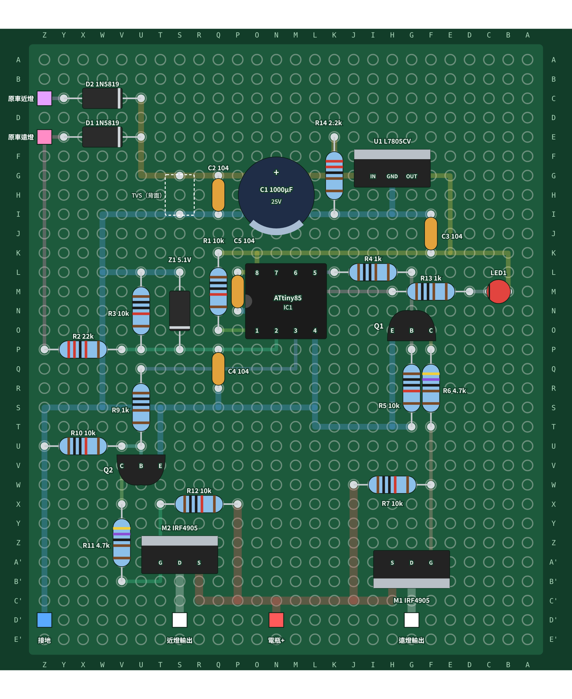
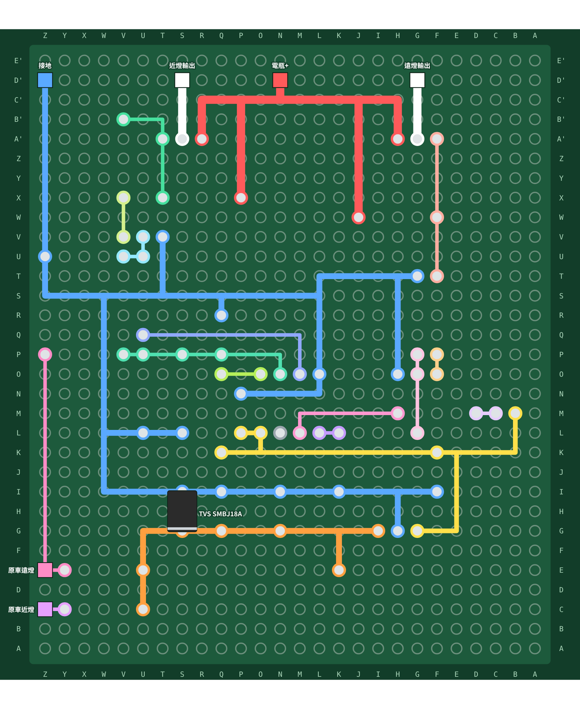

# 洞洞板佈線

照原理圖排版，所有零件在元件面規劃好（TVS 是貼片，設計上就焊在焊接面）。佈線資料用程式檢查過：20 條網路全部連通、沒有短路、零件外形互不重疊。

**[互動版佈線圖](https://allentsou.github.io/attiny85-headlight-toggle/hardware/perfboard.html)**：點任一條線或上方的線路標籤可單獨標亮，方便對照焊接。也可以下載 [perfboard.html](perfboard.html) 離線用瀏覽器開。

> 作者自己的原型板是手工佈線，零件位置和這份不同（照片裡那塊）。這份是整理後的建議佈局，電路完全一樣。

## 座標怎麼看

7×9cm 洞洞板，26 欄 × 31 列，用板子上印的字母當座標，寫成「欄-列」：

- **欄**：從元件面看，由左到右 Z、Y、X … B、A
- **列**：由上到下 A … Z，接著第二輪 A' … E'

例如 `M-L` 是 M 欄、L 列；`G-D'` 是 G 欄、第二輪的 D 列。

## 元件面

零件插在這面。淡色線是背面走線的透視，白色虛線是焊在背面的 TVS。

## 焊接面

把板子**上下翻過來**看（欄的左右不變、列上下顛倒），跟背面印的字母一致，照這張焊。

向量檔：[元件面 SVG](images/perfboard_component_side.svg)、[焊接面 SVG](images/perfboard_solder_side.svg)

## 零件位置

| 編號 | 零件 | 用途 | 孔位 | 方向／備註 |
|---|---|---|---|---|
| D2 | 1N5819 | 原車近燈供電 | A Y-C、K U-C | 色環（陰極）在 U-C |
| D1 | 1N5819 | 原車遠燈供電 | A Y-E、K U-E | 色環（陰極）在 U-E |
| TVS | SMBJ18A | 突波保護 | K S-G、A S-I | 貼片，焊在焊接面，色帶在 S-G |
| C2 | 104 | VIN 濾波 | Q-G – Q-I |  |
| C1 | 1000µF 25V | 儲能 | + N-G、- N-I | 長腳（+）在 N-G，負極色帶朝下 |
| R14 | 2.2k | C1 放電 | K-E – K-I |  |
| U1 | L7805CV | 穩壓 5V | IN I-G、GND H-G、OUT G-G | 直立，印字面朝下（朝板子下緣），背板朝反方向 |
| C3 | 104 | 5V 濾波 | F-K – F-I |  |
| IC1 | ATtiny85 | MCU | 1–4 腳 O-O、N-O、M-O、L-O；5–8 腳 L-L、M-L、N-L、O-L | 缺口朝左（Z 欄方向）；先焊 IC 座 |
| C5 | 104 | IC 電源去耦 | P-L – P-N |  |
| R1 | 10k | 重置上拉 | Q-K – Q-O |  |
| R2 | 22k | 偵測分壓 | Z-P – V-P |  |
| R3 | 10k | 偵測分壓 | U-L – U-P |  |
| Z1 | 1N4733A | 偵測限壓 | A S-L、K S-P | 色環（陰極）在 S-P |
| C4 | 104 | 偵測濾波 | Q-P – Q-R |  |
| R13 | 1k | 狀態燈限流 | H-M – D-M |  |
| LED1 | LED | 狀態燈 | K C-M、A B-M | 長腳（+）在 B-M |
| R9 | 1k | Q2 基極 | U-Q – U-U |  |
| R10 | 10k | Q2 基極下拉 | Z-U – V-U |  |
| Q2 | SS8050 | 近燈驅動 | C V-V、B U-V、E T-V | 平面朝上（朝板子上緣） |
| R11 | 4.7k | M2 閘極 | V-X – V-B' |  |
| R12 | 10k | M2 閘極上拉 | T-X – P-X |  |
| M2 | IRF4905 | 近燈開關 | G T-A'、D S-A'、S R-A' | 直立，印字面朝下（朝板子下緣），背板朝反方向 |
| R4 | 1k | Q1 基極 | K-L – G-L |  |
| Q1 | SS8050 | 遠燈驅動 | E H-O、B G-O、C F-O | 平面朝下（朝板子下緣） |
| R5 | 10k | Q1 基極下拉 | G-P – G-T |  |
| R6 | 4.7k | M1 閘極 | F-P – F-T |  |
| R7 | 10k | M1 閘極上拉 | J-W – F-W |  |
| M1 | IRF4905 | 遠燈開關 | S H-A'、D G-A'、G F-A' | 直立，印字面朝上（朝板子上緣），背板朝反方向 |

## 外接線

| 線 | 孔位 |
|---|---|
| 原車近燈 | Z-C |
| 原車遠燈 | Z-E |
| 接地 | Z-D' |
| 近燈輸出 | S-D' |
| 電瓶+ | N-D' |
| 遠燈輸出 | G-D' |

燈的地線不經過這塊板子，直接接電瓶負極或車架。電瓶+ 要先經過 5A 保險絲。

## 焊接重點

- 由矮到高焊：電阻、二極體 → 104 → IC 座 → LED → SS8050 → 1000µF → 7805、IRF4905。
- **C5（104）緊貼 IC 座左邊，先焊 C5 再焊 IC 座**，IC 座缺口朝左。C5 讓晶片電源腳旁邊有電容，少了它通電時偶爾會開機失敗（原因見 [除錯紀錄](../docs/troubleshooting.md)）。
- **R14（2.2k）是 C1 的放電電阻**，熄火後幾秒內把電容放乾淨，下次開機才會乾淨地重置。
- IC 座底下有兩條線（C5 的地線、PB1）從座子中間走過，先拉好線再焊座子。
- TVS 是貼片，焊在焊接面，跨 S-G 和 S-I，有色帶的一端在 S-G。
- R2、R9、R13、C4 的本體下方有別條線走過，正面躺著焊就好。
- 電瓶線（BATT）和兩條燈輸出走 2～3A，背面用較粗的鍍錫線或補滿錫。
- 焊完先不插晶片，接 12V 量 IC 座第 8 腳對第 4 腳約 5V，再斷電插晶片。
- IC 座第 7 腳（PB2）沒有使用。
